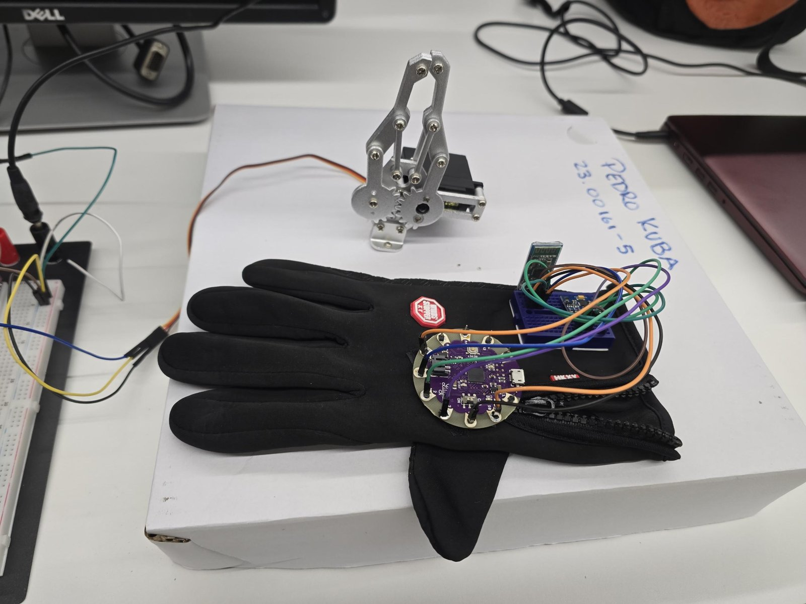
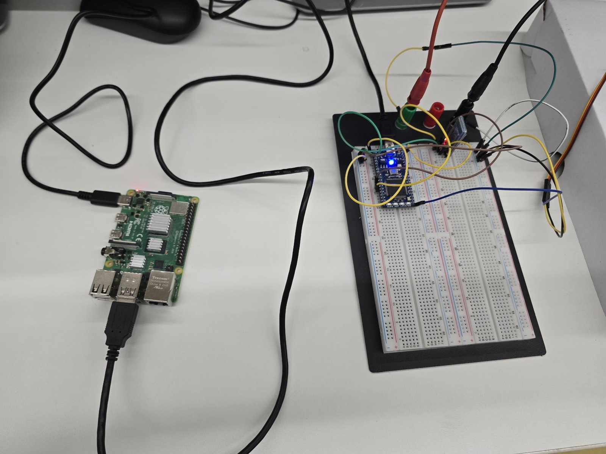
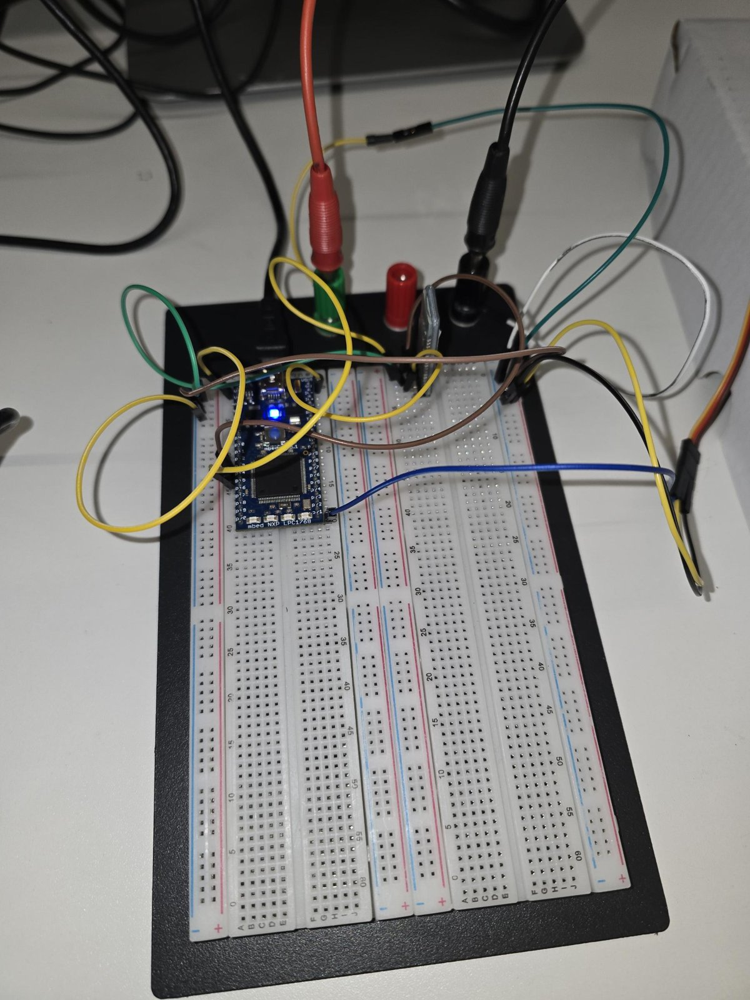
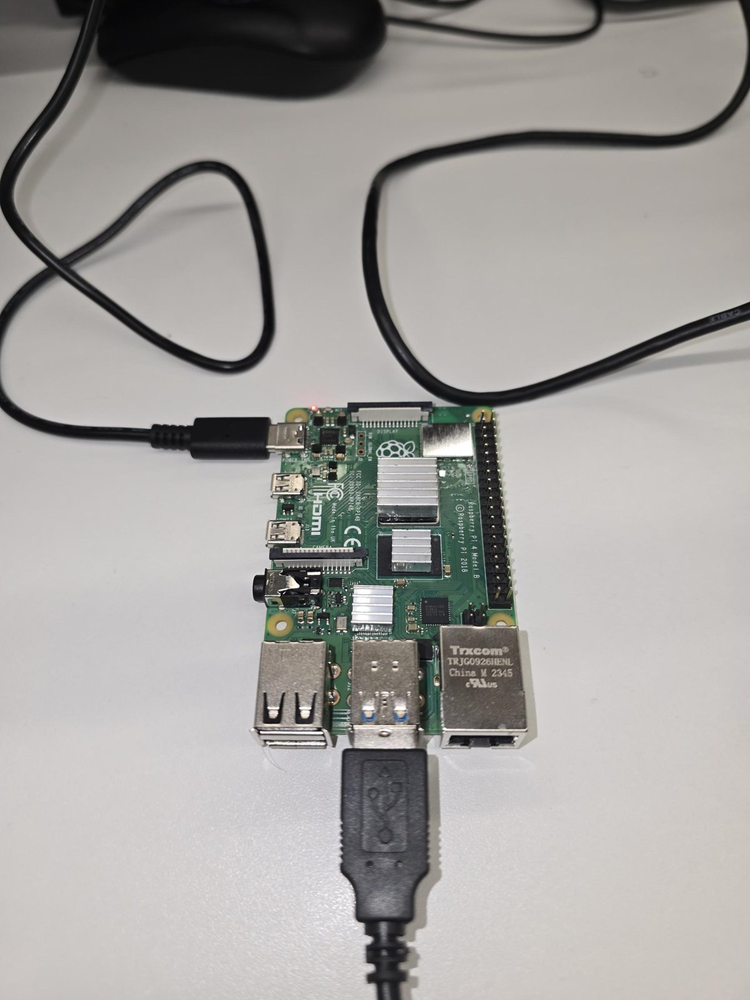
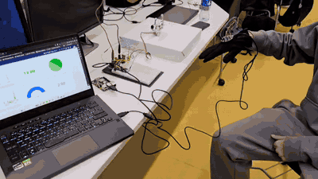
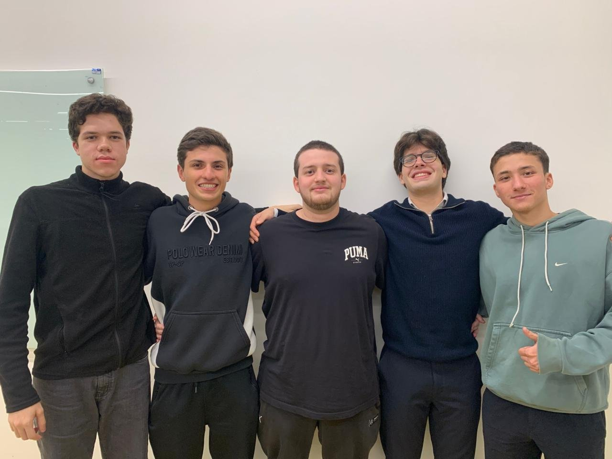

# GloveBot 🤖

Sistema embarcado de **teleoperação robótica vestível** que permite controlar uma garra mecânica através de gestos naturais da mão, via comunicação Bluetooth.

> Projeto desenvolvido para a disciplina de **Microcontroladores e Sistemas Embarcados**.

---

## 📋 Sobre o Projeto

O GloveBot é composto por dois módulos que se comunicam sem fio:

- **Emissor (Luva)** — captura a inclinação do pulso do usuário
- **Receptor (Garra)** — abre/fecha proporcionalmente ao gesto detectado

### Aplicação

Pensado para **robótica industrial e teleoperada**, com uso em cenários onde o operador precisa manipular objetos à distância — ambientes insalubres, perigosos ou de difícil acesso.

---

## 🛠️ Diagrama de Blocos


---

## 🍓 Monitoramento com Raspberry Pi e Dashboard

Além do controle da garra, o GloveBot tem uma camada de **telemetria**: um Raspberry Pi 4 recebe o ângulo da garra e envia os dados, via **MQTT**, para um dashboard online no **Ubidots**.

```
Luva ──Bluetooth──► mbed + Garra ──Serial USB──► Raspberry Pi ──MQTT──► Ubidots
```

### Variáveis enviadas ao dashboard

| Variável | Descrição |
|---|---|
| `angulo` | Ângulo atual da garra (0 a 180) |
| `status_garra` | 0 = fechada, 1 = meio, 2 = aberta |
| `contador_agarramentos` | Quantidade de ciclos aberta → fechada |
| `status_conexao` | 1 = recebendo dados, 0 = sem dados há mais de 2 s |
| `velocidade_movimento` | Variação do ângulo por segundo |

### Dashboard


### Como rodar o script

1. Instale as dependências no Raspberry Pi:
```bash
   sudo apt install python3-serial python3-paho-mqtt
```
2. Abra `raspberry/glovebot_pi.py` e coloque o seu token do Ubidots em `TOKEN`.
3. Com o mbed conectado por USB (aparece como `/dev/ttyACM0`), deixe `MODO_TESTE = False`. Para testar sem hardware, use `MODO_TESTE = True` (ângulo simulado).
4. Execute:
```bash
   python3 glovebot_pi.py
```

> ⚠️ Nunca publique o token do Ubidots no repositório. O arquivo do GitHub usa `SEU_TOKEN_AQUI`.

> 💡 Nos gráficos do Ubidots, use um período **relativo** (ex.: *Last 5 minutes*). Com um período fixo, o gráfico não acompanha os dados em tempo real.

---

## 📸 Galeria do Projeto

### Luva e garra


### Sistema completo: Raspberry Pi e receptor


| Receptor (mbed + HC-08 na protoboard) | Raspberry Pi 4 |
|---|---|
|  |  |

### 🎥 Vídeo de Demonstração

Movimento da luva controlando a garra e os dados chegando ao dashboard do Ubidots em tempo real.



[▶️ Assistir vídeo de demonstração](docs/video_demonstracao.mp4)

---

## 📦 Componentes

### Emissor (Luva)
| Componente | Função |
|---|---|
| LilyPad IOT ATMega32U4 | Microcontrolador vestível |
| MPU-6050 | Acelerômetro/giroscópio |
| HC-08 (Master) | Bluetooth 4.0 BLE |
| Cabo USB (PC) | Alimentação e gravação do código |

### Receptor (Garra)
| Componente | Função |
|---|---|
| mbed LPC1768 (Cortex-M3) | Microcontrolador principal |
| HC-08 (Slave) | Bluetooth 4.0 BLE |
| Servo MG995 | Atuador da garra |
| Fonte 5V-2A externa | Alimentação do servo |

### Monitoramento
| Componente | Função |
|---|---|
| Raspberry Pi 4 Model B | Gateway: lê o ângulo do mbed pela USB e publica via MQTT |
| Ubidots (STEM) | Dashboard online |

---

## 🔌 Pinagem

### Emissor — LilyPad
| Periférico | Pino |
|---|---|
| MPU-6050 SDA | pino 2 |
| MPU-6050 SCL | pino 3 |
| HC-08 TXD | pino 9 |
| HC-08 RXD | pino 10 |

### Receptor — mbed LPC1768
| Periférico | Pino |
|---|---|
| Servo MG995 (PWM) | p21 |
| HC-08 TX (RX do mbed) | p14 |
| HC-08 RX (TX do mbed) | p13 |
| HC-08 VCC | VOUT (3,3 V) |
| Servo VCC / GND | +5 V / GND da fonte externa |
| GND da fonte | GND do mbed (**terra comum obrigatório**) |

---

## 📡 Protocolo de Comunicação

A luva envia comandos em formato simples via Bluetooth:

```
A<angulo>\n
```

**Exemplos:**
- `A0\n` → garra completamente fechada
- `A90\n` → garra na posição central
- `A180\n` → garra completamente aberta

O mbed repassa cada ângulo válido pela Serial USB (`<angulo>\n`, 9600 baud) para o Raspberry Pi.

### Ajustes do movimento

| Onde | Parâmetro | Efeito |
|---|---|---|
| Luva | `ROLL_FECHADO` / `ROLL_ABERTO` | Faixa de giro da mão para o curso completo (sensibilidade) |
| Luva | `ALPHA` | Filtro contra tremor (menor = mais suave) |
| Luva | `DEADBAND` | Variação mínima para mudar o ângulo |
| Garra | `LIM_MIN` / `LIM_MAX` | Curso permitido do servo (evita forçar nos limites da garra) |
| Garra | `PASSO_MAX` | Velocidade máxima do servo (evita picos de corrente) |
| Garra | `SERVO_INVERTIDO` | Inverte o sentido, conforme a montagem da garra |

---

## 🚀 Como Compilar

### Emissor (Arduino IDE)
1. Instale a biblioteca `MPU6050` da Electronic Cats
2. Selecione a placa **LilyPad Arduino USB**
3. Abra `emissor/GloveBot_emissor.ino`
4. Faça o upload

### Receptor (mbed LPC1768)
O Keil Studio Cloud foi desativado, então o receptor é compilado localmente com o **mbed-tools** (Mbed OS 6.17) e o GCC ARM.

**Jeito rápido:** arraste `receptor/GloveBot_receptor.bin` para a unidade **MBED** e aperte RESET.

**Para recompilar:**
```bash
pip install mbed-tools
cd receptor
git clone --depth 1 --branch mbed-os-6.17.0 https://github.com/ARMmbed/mbed-os.git
mbed-tools compile -m LPC1768 -t GCC_ARM
```
O `.bin` sai em `cmake_build/LPC1768/develop/GCC_ARM/GloveBot.bin`.

---

## 🔗 Pareamento Bluetooth

Os módulos HC-08 são configurados via comandos AT, usando o sketch `emissor/HC08_config_luva.ino` e o Monitor Serial (9600 baud, **No line ending**, comandos em maiúsculas):

- **Emissor (LilyPad)**: **Master** com `AT+ROLE=M` e `AT+CONT=0` (conectável)
- **Receptor (mbed)**: mantido como **Slave** (padrão de fábrica)

Comandos úteis: `AT` (teste), `AT+RX` (nome, papel, endereço), `AT+CONT=?` (deve mostrar `Connectable`), `AT+CLEAR` (apaga o slave memorizado).

> ⚠️ `AT+CONT=1` deixa o master **Non-Connectable** e ele nunca pareia.

Ao ligar o mbed e depois a luva, o pareamento ocorre automaticamente: os LEDs dos dois HC-08 param de piscar e ficam fixos. Depois de configurar, grave de novo `emissor/GloveBot_emissor.ino` na luva.

---

## 👥 Equipe



- Enzo Medeiros Grando
- Pedro Kuba Bloise
- Gustavo Henrique Lamberti Widosnck
- Gabriel Coutinho
- João Victor Pessoa de Lima dos Anjos

---

## 📄 Licença

Distribuído sob a licença MIT. Veja `LICENSE` para mais informações.
